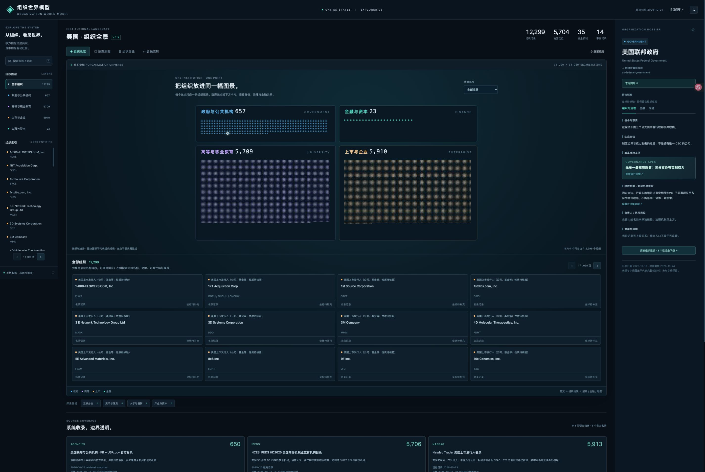

# 组织世界模型 · Organization World Model

把**组织在哪里、属于谁、如何形成决定、资金如何流动**放进一幅可探索的社会地图。美国是首个案例；Institutional Atlas 保留为代码仓库名称。

[打开组织世界模型本地首页](http://127.0.0.1:8765/)



## v0.3 能做什么

- **组织总览（默认首页）**：按领域显示全部收录记录，每个光点对应一个组织身份；全文搜索、学位/非学位筛选、完整分页目录。
- **独立地理地图**：真实美国 50 州与 DC 州界、AK/HI 插图、组织位置、聚合点、拖动与缩放、事件光圈。
- **组织层级**：联邦三分支、15 个行政部门、重点下属机构、大学系统、企业与金融机构的正式结构；点击继续下钻。
- **治理档案**：官网、使命、生态定位、最高治理主体、议事与共识形成程序、负责人和逐项来源。
- **金融流转**：财政与公共服务、货币与信贷、资本与创新三条探索路径；来源、用途、机制说明与官方证据。
- **事件观察**：有日期的官方新闻卡片，按领域、当前机构与近 30/90 天筛选，点击联动地图。
- **可维护本地模型**：官方名录快照 + Markdown 事实源 → 校验 → JSON / 单文件 HTML。搜索、深链接、JSON 导出、响应式布局与键盘操作。

这一版采用 **3 个可复建的官方完整名录 + 深度研究档案**：政府及公共机构 650 个目录身份、IPEDS 5,706 个教学机构、Nasdaq 5,913 个发行人名称组。精确匹配已有档案，并合并已核实的跨目录重复身份，得到 **12,299 条组织记录（143 份研究档案）**；最新合并后记录总数见 [`dist/atlas.json`](dist/atlas.json) 的 metadata，字段覆盖见 [`dist/coverage.json`](dist/coverage.json)。12 家地区联储已齐备，包含 101 条正式结构关系、35 条金融机制和 14 条官方事件。

目录具有明确范围：政府索引含历史机构且尚不涵盖所有州/地方政府；教育机构中 3,877 个授予学位，其余为非学位教育；上市发行人包括外国公司、基金和 SPAC，名称组不保证唯一法人，不能声称已收录全部美国本土公司。没有坐标或金融事实的组织仍在总览中，未知值保持为空。

## 使用

macOS 双击 [`启动世界模型.command`](启动世界模型.command)。旧的 `启动视觉模型.command` 和 `启动图谱.command` 继续兼容。也可直接打开 [`dist/index.html`](dist/index.html)；页面、地图和数据均已内嵌，不需要地图 API key。官网/来源链接需联网。

本地开发：

```bash
scripts/dev.sh setup
scripts/dev.sh check
scripts/dev.sh build
scripts/dev.sh open
```

浏览器地址：<http://127.0.0.1:8765/>。Python 3.9+ 用于构建；Node.js 20+ 仅用于前端开发测试，打开产物无需 Node。服务只提供 `dist/`，监听本机。

v0.3 总览使用四条批量绘图路径保留全部光点，SVG 元素总量固定在约 26 个；目录与卡片分页。金融图按内容高度滚动，窄屏只在图内横向滚动，避免节点增多后文字被压缩。

示例路径：

- [联邦三分支](http://127.0.0.1:8765/#us-federal-government?view=structure)
- [加州大学与十个校区](http://127.0.0.1:8765/#uc-system?view=structure)
- [联储与货币机制](http://127.0.0.1:8765/#us-fed?view=finance)
- [斯坦福大学](http://127.0.0.1:8765/#stanford?domain=university)
- [微软公司](http://127.0.0.1:8765/#microsoft?domain=enterprise)

## 数据语义

正式组成、汇报、控制、职能授权和经量化证明的持续资金依赖进入结构层。普通监管、银行贷款、合同与一次资助不会自动成为隶属关系。国家是导航范围，三权分立中的国会与最高法院不向总统汇报。

金融图展示**有依据的制度机制**，线宽不代表金额；家庭、投资者等概念部门不算组织。机构资金模型的业务归纳按来源说明性质。预算授权、拨款、支出承诺、实际支出、收入和净利润分开处理，未知金额保留为空。

事件是截至 **2026-10-24** 的人工核验快照；事件光圈使用关联机构的位置，不能解读为现场位置。地图位置以 NCES 报告的校园经纬度为主，研究档案也含官方地址确认城市后的近似坐标；各条记录显示精度，不能用于导航。

研究记录：[政府与事件](docs/RESEARCH_GOVERNANCE_2026-10-24.md)、[大学、企业与金融](docs/RESEARCH_UNIVERSE_2026-10-24.md)、[地图来源与许可](docs/MAP_SOURCES.md)。未补齐字段和范围见 [覆盖说明](docs/COVERAGE.md)。

## 目录与维护

```text
institutional-atlas/
├── VISION.md                 # 定位与纲要
├── data/catalogs/            # 可复建的完整目录记录
├── data/sources/             # 官方原始快照与校验哈希
├── data/catalog-links.json   # 人工核实的跨目录同一身份
├── data/entities/            # 逐项研究的组织 Markdown
├── data/events/              # 日期明确的官方事件
├── data/flows/               # 有来源的金融机制
├── data/geography/           # 许可、来源、真实州界资产
├── web/                      # HTML / CSS / JavaScript
├── scripts/                  # 校验、构建和本地服务
├── tests/                    # 数据与前端契约测试
├── dist/                     # 自动生成的可离线产物
└── docs/                     # 本体、数据规范、研究、覆盖
```

编辑 Markdown / `web/` 后构建并测试；不要手改 `dist/`。工作规范见 [AGENTS.md](AGENTS.md)，字段见 [数据模型](docs/DATA_MODEL.md)，语义见 [本体](docs/ONTOLOGY.md)，开发步骤见 [本地开发](docs/LOCAL_DEVELOPMENT.md)。

聊天原文、下载包、私人思路与过程截图继续放在仓库外的同级 `project-context/`，不参与 Git 同步。

名录方法与离线复建：[政府](docs/CATALOG_GOVERNMENT.md)、[教育](docs/CATALOG_COLLEGES.md)、[上市发行人](docs/CATALOG_COMPANIES.md)。原始目录保留各自来源与使用条件，代码许可证不重新授权第三方数据。

代码采用 [MIT License](LICENSE)。美国地图资产另附 ISC 许可和 Census 衍生来源。界面参考 [World Monitor](https://github.com/koala73/worldmonitor) 与 [God’s Eye View](https://github.com/bilawalsidhu/gods-eye-view) 的多层空间观察方式，没有复制其应用代码。项目与所示组织无官方隶属或背书关系。
